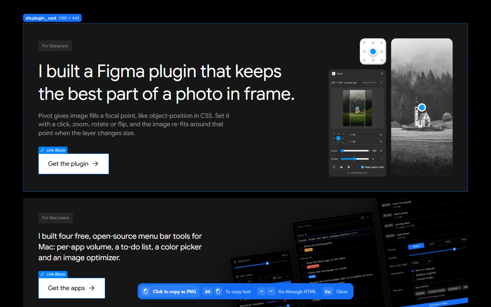

# Element Grabber

A Chrome extension that copies any element on a page as a PNG, or grabs its text. One shortcut, no DevTools.



## Install

**Chrome Web Store:** in review. The link will be added here once it is published.

**From source:**

1. Download or clone this repository.
2. Open `chrome://extensions` and turn on Developer mode.
3. Click Load unpacked and pick the `extension` folder.

It works in Chrome and other Chromium browsers such as Edge, Brave and Arc.

## Use

| Action | What it does |
| --- | --- |
| `Ctrl+Shift+X` (`Cmd+Shift+X` on a Mac) or the toolbar icon | Starts the picker |
| Click | Copies the element as a PNG |
| `Alt` + click (`Cmd` + click on a Mac) | Copies the element's text |
| `↑` / `↓` | Selects the parent or the child element |
| `Esc` | Closes the picker or cancels a running capture |

You can change the shortcut at `chrome://extensions/shortcuts`.

## What it does

- Copies an element as a PNG, even when it is taller or wider than the window. The page scrolls on its own and the pieces are stitched together.
- Copies text from places where you cannot select it, such as text inside a link or a button.
- Cleans the copied text: non-breaking spaces and invisible characters become plain spaces.
- Works on top of modals and inside scrolling panels.

## How it works

- Nothing runs on a page until you start the picker. The extension only asks for `activeTab` and `scripting`.
- A PNG is a capture of the visible tab, cropped to the element. For a bigger element the extension scrolls the page and any scrolling panel around the element, captures it in tiles and puts them together. Fixed and sticky bars are hidden while it shoots, then everything is put back.
- Text is the rendered text of the element.

Good to know:

- Copying a PNG needs an https page. Copying text works everywhere.
- Extensions cannot run on the Chrome Web Store or on Chrome's own pages.

## Privacy

Everything happens in your browser. Nothing is stored and nothing is sent anywhere. The full policy is at [vojtechokenka.com/element-grabber/privacy](https://vojtechokenka.com/element-grabber/privacy).

## Development

The extension is plain JavaScript with no build step. The files in `extension` are what ships.

The tests drive a real Chromium with the extension loaded:

```bash
cd test
npm install
node run.mjs ../extension "<path to a Chromium binary>" ../out 1
```

The last argument is the device scale factor. `action.mjs` runs a shorter check through a real toolbar click.

## License

MIT. Made by [Vojtěch Okénka](https://vojtechokenka.com).
